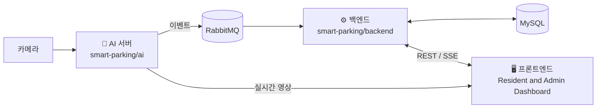

# PCS — Parking Control System

AI 카메라 기반 **아파트 스마트 주차 관리 시스템**입니다. 캡스톤 디자인 프로젝트예요.
카메라가 주차칸 점유와 불법주차를 자동으로 감지하고, 관리자와 입주민은 웹 대시보드에서 실시간으로 확인합니다.

## 📁 버전

| 버전 | 폴더 | 설명 |
|---|---|---|
| **v1 — 캡스톤 디자인** | [`v1-capstone/`](v1-capstone) | 캡스톤 디자인 제출·발표(2026-06-02) 당시의 원본 코드 (기능 그대로, [보안 수정](v1-capstone/SECURITY.md)만 적용) |
| **v2 — 업그레이드** ⭐ | [`v2-upgrade/`](v2-upgrade) | 동작하지 않는 더미 코드를 정리하고, 코드를 최적화하고, 구조 문서를 추가한 버전. 클론 후 바로 실행되도록 설정 정리 (기능은 v1과 같음) |

두 버전 모두 **실제로 개발한 폴더 구조 그대로** 두 폴더로 되어 있습니다.

| 폴더 | 내용 | v1 | v2 |
|---|---|---|---|
| 🖥️ **Resident and Admin Dashboard** | 프론트엔드: 관리자·입주민 웹 대시보드 (React, TypeScript, Vite, Tailwind) | [보기](<v1-capstone/Resident and Admin Dashboard>) | [보기](<v2-upgrade/Resident and Admin Dashboard>) |
| ⚙️🤖 **smart-parking** | `backend/` API 서버 · `ai/` AI 서버 · `db/` 스키마 · `infra/` Docker | [보기](v1-capstone/smart-parking) | [보기](v2-upgrade/smart-parking) |

```
v2-upgrade/
├── Resident and Admin Dashboard/   🖥️ 프론트엔드   (VSCode로 이 폴더를 열면 전체 자동 시작)
└── smart-parking/
    ├── backend/                    ⚙️ 백엔드 API 서버 (Node.js, Express)
    ├── ai/                         🤖 AI 서버 (Python, OpenCV)
    ├── db/                         MySQL 스키마·시드
    └── infra/                      Docker Compose (MySQL, RabbitMQ, MediaMTX)
```

**처음 보신다면 v2부터 보시길 권해요.** 실행 방법은 [v2-upgrade/README.md](v2-upgrade/README.md)에 있어요.

## 시스템 구성



## 주요 기능

- **주차칸 점유 감지**: 구역별 배경 차분(MOG2)과 디바운스로 장난감 차까지 감지
- **불법주차 실시간 경보**: 금지구역 점유와 이중주차를 3초 안에 대시보드 배너로 표시
- **입출차 세션**: 입차하면 AI가 주차 칸을 자동으로 확정하고, 출차하면 이력으로 남김
- **선호 주차칸 분석** (차별화 기능): 입주민이 자주 쓰는 칸 TOP 3와 그 칸이 지금 비어있는지 표시
- **입주민 알림**: 입차 시 빈자리와 선호칸 안내, 출차 시 알림 (소리·진동)
- 관리자: CCTV, 위반 관리, 회원 관리, 방문자 승인 / 입주민: 내 차량, 주차 이력, 방문자 등록

## v1 → v2에서 바뀐 점

| 파트 | 정리 내용 |
|---|---|
| 프론트엔드 | 구버전 페이지 2개, 호출처 없는 API 함수, 동작하지 않던 Lumi fallback, 참조 없는 엔티티 10개, 일회성 스크립트 삭제. VSCode 태스크를 상대경로로, `.env.example`을 실제 변수로 교체. lockfile 동기화 |
| 백엔드 | `index.js` 1353줄 → 874줄 (AI 채팅, 항상 에러가 나던 `/debug/*`, 호출처 없는 엔드포인트 삭제). 구버전 서버 파일 삭제. **API 키 없이 실행 가능**. `npm start` 등 스크립트 추가. 데모 시드의 이중주차 오탐 수정 |
| AI 서버 | 쓰지 않는 Flask 서버 모드, 디버그 스크립트, 라즈베리파이 파일 삭제. `.env.example`을 같은 PC 실행 기준으로 수정. YOLO는 선택 설치(`requirements-yolo.txt`)로 분리 |
| 보안 | **API 인증(Lumi 토큰) + 역할별 권한 + 본인 데이터 제한**, 쿼리 객체 주입 차단, DB·관리 화면 포트를 이 PC로 제한, 의존성 취약점 해결, CORS 허용 목록, AI 영상 인증 → [SECURITY.md](v2-upgrade/SECURITY.md) |
| 문서 | 각 폴더에 README(실행 가이드)와 `docs/ARCHITECTURE.md`(코드 구조) 추가 |
