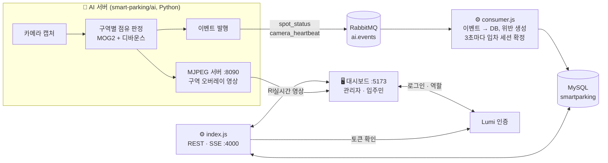
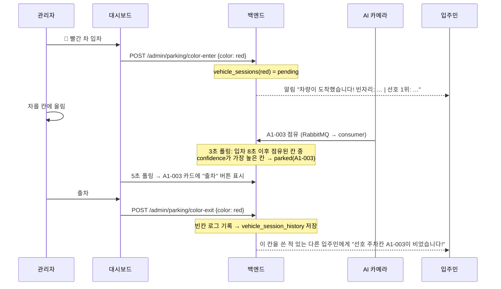
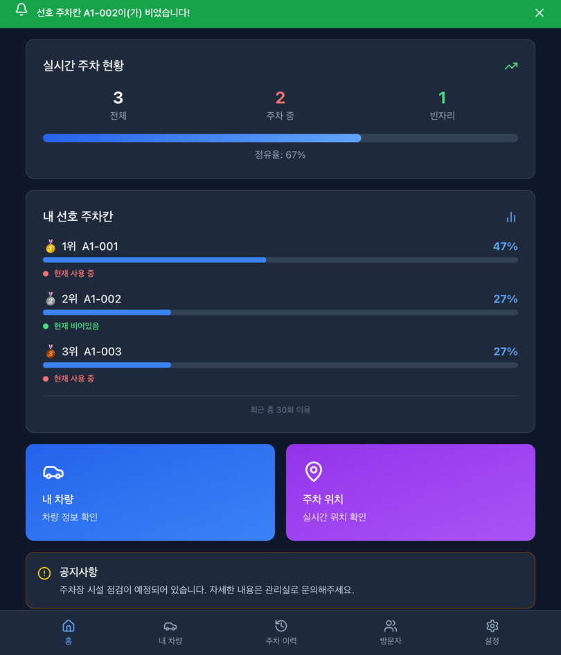

# PCS — Parking Control System

AI 카메라 기반 **아파트 스마트 주차 관리 시스템**입니다. 캡스톤 디자인 프로젝트예요 (발표 2026-06-02).
카메라 한 대가 주차칸 점유와 불법주차를 자동으로 감지하고, 관리자와 입주민은 웹 대시보드에서 실시간으로 확인합니다.
여기에 더해 **입주민이 자주 쓰는 주차칸과 그 칸이 지금 비어있는지**를 알려 주는 것이 이 프로젝트의 차별화 기능입니다.

| 구분 | 내용 |
|---|---|
| AI | Python · OpenCV (구역별 MOG2 배경 차분 + 디바운스) |
| 메시지 큐 | RabbitMQ (`ai.events` 큐) |
| 백엔드 | Node.js · Express 4 · mysql2 · amqplib (REST + SSE) |
| DB | MySQL 8 |
| 프론트엔드 | React 18 · TypeScript · Vite 6 · Tailwind CSS · React Router 6 · hls.js |
| 인증 | Lumi SDK (ADMIN / USER 역할) |
| 인프라 | Docker Compose (MySQL, RabbitMQ, MediaMTX, Adminer) |
| 하드웨어 | USB 웹캠 (Jetson Orin Nano 설치 스크립트 포함) + 장난감 차 3대 모형 |

## 목차

1. [버전 안내 (v1 / v2)](#1-버전-안내-v1--v2)
2. [프로젝트 배경과 목표](#2-프로젝트-배경과-목표)
3. [데모 환경](#3-데모-환경)
4. [시스템 구성](#4-시스템-구성)
5. [동작 원리](#5-동작-원리)
6. [화면 구성](#6-화면-구성)
7. [데이터베이스](#7-데이터베이스)
8. [REST API 요약](#8-rest-api-요약)
9. [실행 방법](#9-실행-방법)
10. [폴더 구조](#10-폴더-구조)
11. [보안](#11-보안)
12. [v1 → v2에서 바뀐 점](#12-v1--v2에서-바뀐-점)
13. [개발 과정](#13-개발-과정)
14. [알려진 한계와 향후 과제](#14-알려진-한계와-향후-과제)
15. [문서 모음](#15-문서-모음)

---

## 1. 버전 안내 (v1 / v2)

| 버전 | 폴더 | 설명 |
|---|---|---|
| **v1 — 캡스톤 디자인** | [`v1-capstone/`](v1-capstone) | 캡스톤 디자인 제출·발표(2026-06-02) 당시의 원본 코드 (기능 그대로, [보안 수정](v1-capstone/SECURITY.md)만 적용) |
| **v2 — 업그레이드** ⭐ | [`v2-upgrade/`](v2-upgrade) | 동작하지 않는 더미 코드를 정리하고, 코드를 최적화하고, 구조 문서를 추가한 버전. 클론 후 바로 실행되도록 설정 정리 (기능은 v1과 같음) |

두 버전 모두 **실제로 개발한 폴더 구조 그대로** 두 폴더로 되어 있습니다.

| 폴더 | 내용 | v1 | v2 |
|---|---|---|---|
| 🖥️ **Resident and Admin Dashboard** | 프론트엔드: 관리자·입주민 웹 대시보드 | [보기](<v1-capstone/Resident and Admin Dashboard>) | [보기](<v2-upgrade/Resident and Admin Dashboard>) |
| ⚙️🤖 **smart-parking** | `backend/` API 서버 · `ai/` AI 서버 · `db/` 스키마 · `infra/` Docker | [보기](v1-capstone/smart-parking) | [보기](v2-upgrade/smart-parking) |

**처음 보신다면 v2부터 보시길 권해요.** 아래 설명과 경로는 모두 v2 기준입니다.

---

## 2. 프로젝트 배경과 목표

### 문제

아파트 주차장의 불법주차·무단점거는 입주민 갈등의 주요 원인인데, 지금은 관리자가 직접 순찰하며 위반 차량을 찾는 방식에 기대고 있습니다.

- 관리자가 없을 때는 바로 대응할 수 없다
- 위반 기록이 체계적으로 남지 않는다
- 입주민은 주차장에 들어가기 전까지 빈자리를 알 수 없다
- 빈자리를 찾느라 주차장을 도는 시간이 든다

### 목표

| 목표 | 구현 방법 |
|---|---|
| 주차칸 점유를 사람 없이 자동으로 파악 | 카메라 영상에서 구역별 배경 차분으로 점유 판정 |
| 불법주차를 바로 알리고 기록 | 금지구역 점유·이중주차 감지 → 위반 생성 + 증거 저장 → 관리자 화면에 3초 주기 경보 |
| 입주민에게 실시간 주차 정보 제공 | 모바일 입주민 화면에 빈자리, 내 차 위치, 주차 이력 표시 |
| **차별화: 선호 주차칸 안내** | 이용 이력을 집계해 내가 자주 쓰는 칸 순위와 지금 비었는지를 함께 표시, 그 칸이 비면 알림 |

---

## 3. 데모 환경

발표는 실제 주차장이 아닌 **책상 위 주차장 모형**으로 진행했습니다.

| 항목 | 구성 |
|---|---|
| 카메라 | 웹캠 1대가 모형 전체를 위에서 촬영 (코드상 `CAM-GATE-01` / 장치 `PI-01`) |
| 주차칸 | 일반 칸 3개 `A1-001`, `A1-002`, `A1-003` + 칸 아래 통로를 덮는 금지구역 `A1-999` |
| 차량 | 장난감 차 3대. 색깔별로 입주민 차량에 연결 |
| 서버 | 노트북 한 대에서 Docker(MySQL·RabbitMQ·MediaMTX) + 백엔드 + AI 서버 + 프론트를 함께 실행 |
| 클라이언트 | 관리자 화면은 노트북 브라우저, 입주민 화면은 iPad 등 같은 네트워크의 기기 (`pnpm dev --host`) |

| 장난감 차 | 입주민 | 번호판 |
|---|---|---|
| 🔴 빨간 차 (`red`) | 김근영 | 12가3456 |
| 🔵 파란 차 (`blue`) | 정문영 | 34나5678 |
| ⬜ 회색 차 (`gray`) | 박지민 | 56다9012 |

장난감 차는 번호판을 읽을 수 없어서, 색깔↔번호판 연결을 백엔드의 `VEHICLE_COLOR_MAP`에 고정해 두고 관리자가 "입차" 버튼으로 어떤 차가 들어왔는지 알려 줍니다 (게이트 센서·번호판 인식의 대체). 어느 칸에 섰는지는 AI가 스스로 찾습니다.

---

## 4. 시스템 구성



| 구성 요소 | 역할 | 포트 |
|---|---|---|
| AI 서버 (`ai/main.py`) | 프레임 캡처 → 구역별 점유 판정 → RabbitMQ 발행, 오버레이 영상 제공 | 8090 (MJPEG `/stream`, `/snapshot`) |
| RabbitMQ | AI와 백엔드 사이의 이벤트 버퍼. AI 장치가 따로 있어도 메시지가 유실되지 않음 | 5672 / 15672 (관리 UI) |
| `consumer.js` | 큐 메시지를 트랜잭션으로 DB에 반영, 금지구역 위반 생성·해제, 입차 세션 확정 폴링 | — |
| `index.js` | 대시보드용 REST API, 미처리 위반 SSE 스트림, 입출차·알림 처리 | 4000 |
| MySQL 8 | 모든 상태와 이력 저장 (`spot_status_logs`가 실시간 데이터의 원천) | 3306 |
| 대시보드 | 관리자(데스크톱, 다크 테마) / 입주민(모바일, 하단 탭) 화면 | 5173 |
| MediaMTX | RTSP → HLS 변환 (실제 CCTV 카메라 연결용. 데모 화면은 MJPEG 사용) | 8554 / 8888 / 8889 |
| Adminer | DB 웹 관리 화면 | 8080 |

---

## 5. 동작 원리

### 5-1. 주차칸 점유 감지 (`ai/detection/zone_occupancy.py`)

YOLO 같은 차량 탐지 모델 대신 **구역별 배경 차분**을 씁니다. 장난감 차처럼 "실제 차처럼 생기지 않은 물체"도 칸 안에 놓이기만 하면 감지되고, CPU만으로 가볍게 돌아갑니다.

```
카메라 프레임 (FRAME_INTERVAL = 2초 간격)
  → 그레이스케일 변환
  → 구역(폴리곤)마다 독립된 MOG2 배경 모델에 적용
       ├─ 처음 20프레임(약 40초): learningRate = -1  → 빈 주차장을 배경으로 학습
       └─ 이후:                  learningRate = 0   → 배경 고정 (오래 서 있는 차가 배경으로 흡수되지 않음)
  → 그림자 픽셀(값 127) 제외, 진짜 전경(255)만 남김
  → 구역 안 전경 픽셀 비율(ratio) 계산
  → ratio > 구역 임계값 이 연속 5프레임  → "점유" 확정
    ratio ≤ 구역 임계값 이 연속 5프레임  → "비어있음" 확정
    그 사이                            → 이전 상태 유지 (조명·그림자 깜빡임 방지)
```

| 파라미터 | 값 | 위치 | 의미 |
|---|---|---|---|
| `FRAME_INTERVAL` | 2.0초 | `ai/.env` | 분석 주기 |
| `WARMUP_FRAMES` | 20 | `zone_occupancy.py` | 배경 학습 프레임 수 (2초 × 20 = 약 40초) |
| MOG2 | `history=40`, `varThreshold=50`, `detectShadows=True` | `zone_occupancy.py` | 배경 모델 설정 |
| 일반 칸 임계값 | 0.15 | `zones.py` | 칸 면적의 15% 이상이 바뀌면 "차 있음" 후보 |
| 금지구역 임계값 | 0.10 | `zones.py` | 통로 전체를 덮는 넓은 구역이라 낮게 설정 |
| `DEBOUNCE_FRAMES` | 5 | `zone_occupancy.py` | 상태 전환에 필요한 연속 프레임 (약 10초) |
| 캘리브레이션 해상도 | 1280 × 720 | `zone_occupancy.py` | 폴리곤 좌표 기준. 실제 프레임 크기에 맞춰 자동 스케일 |

- 구역 폴리곤 좌표는 `python calibrate_zones.py`로 화면을 클릭해 측정하고 `ai/detection/zones.py`에 넣습니다.
- 상태가 바뀔 때마다 `spot_status` 이벤트를 발행하고, 바뀌지 않아도 **30초마다 전체 상태를 다시 보내** 서버와 어긋난 상태를 스스로 복구합니다. 카메라 생존 신호 `camera_heartbeat`도 30초마다 보냅니다.
- 오버레이 영상에서는 점유 칸이 빨강, 빈 칸이 초록, 금지구역은 항상 빨간 테두리로 표시됩니다.
- `detector.py`(YOLOv8)와 `export_onnx.py`는 실제 차량 환경을 위한 확장용으로 남겨 두었고, 현재 실행 경로에서는 쓰지 않습니다 (`requirements-yolo.txt`로 선택 설치).

### 5-2. 이벤트 처리 (`backend/consumer.js`)

AI가 보내는 메시지 형식은 다음과 같습니다.

```json
{
  "event_id": "uuid",
  "event_type_code": "spot_status",
  "camera_code": "CAM-GATE-01",
  "device_code": "PI-01",
  "ts": "2026-05-31T12:00:00+00:00",
  "spot_id": "A1-002",
  "confidence": 0.61,
  "payload": { "is_occupied": 1 }
}
```

consumer는 메시지 하나를 **하나의 DB 트랜잭션**으로 처리합니다.

1. 처음 보는 장치·카메라 코드면 `devices`·`cameras`에 자동 등록
2. `spot_status_logs`에 점유 상태와 confidence(= 전경 비율) 기록
3. 금지구역(`spot_type_code = 'forbidden'`)이 점유되면 `forbidden_occupied` 위반을 만들고(이미 열린 위반이 있으면 재사용) `evidences`에 증거를 추가
4. 칸이 비면 그 칸의 열린 위반을 자동으로 `resolved` 처리

### 5-3. 불법주차 감지 2종 (`GET /spots/forbidden-occupied`)

| 유형 | 판정 조건 |
|---|---|
| `forbidden` 금지구역 점유 | 금지구역의 가장 최근 로그가 `is_occupied = 1` |
| `double_parked` 이중주차 | 일반 칸이 점유되어 있는데, 그 칸에 `parked` 상태인 입차 세션이 없음 (= 입차 등록 없이 들어온 차) |

관리자 대시보드가 이 API를 **3초마다** 조회해 상단에 빨간 경보 배너를 띄웁니다. 미처리 위반 목록은 백엔드가 5초마다 SSE(`/events/stream`)로 밀어 주고, SSE가 끊기면 30초 폴링으로 자동 전환합니다.

### 5-4. 색깔 기반 입출차 세션



- 세션 상태: `pending`(입차 버튼, 칸 미확정) → `parked`(AI가 칸 확정) → `exited`(출차). 완료된 세션은 `vehicle_session_history`에 쌓여 주차 이력·선호칸 통계가 됩니다.
- **입차 8초 이후의 점유만** 인정합니다. 차를 올리는 손·팔이 다른 칸에 먼저 잡히는 오인식을 막기 위한 규칙입니다.
- `pending` 세션은 한 번에 하나만 허용합니다 (두 대가 동시에 감지 중이면 어느 차가 어느 칸인지 알 수 없으므로 409 응답).
- 금지구역에 선 차는 세션이 없으므로, 관리자가 칸 단위 수동 출차(`POST /admin/parking/exit`)로 처리합니다.

### 5-5. 선호 주차칸 분석 (`GET /parking/spot-preference`) — 차별화 기능

두 출처의 이용 기록을 합산해 차량별 칸 순위를 만듭니다.

```sql
SELECT spot_id, zone, SUM(visit_count) AS visit_count
FROM (
  -- ① 색깔 입출차로 완료된 세션 이력
  SELECT spot_id, zone, COUNT(*) FROM vehicle_session_history ... WHERE plate_no = ?
  UNION ALL
  -- ② AI 감지 로그 중 번호판이 연결된 점유 기록
  SELECT spot_id, zone, COUNT(*) FROM spot_status_logs JOIN plates ... WHERE plate_no = ? AND is_occupied = 1
) combined
GROUP BY spot_id, zone
ORDER BY visit_count DESC
LIMIT 5          -- 비활성 칸·금지구역은 두 쿼리 모두에서 제외
```

그다음 각 칸의 **가장 최근 로그**로 지금 비어있는지(`is_available`)를 붙이고, 이용 비율(`percentage`)을 계산해 돌려줍니다. 입주민 홈 화면은 상위 3개를 🥇🥈🥉와 "현재 사용 중 🔴 / 현재 비어있음 🟢"으로 보여 주고 10초마다 갱신합니다.

데모 시드(`db/demo-seed.sql`)를 넣은 뒤 김근영(12가3456)으로 조회하면 다음과 같습니다.

```json
{
  "preferred_spots": [
    { "spot_id": "A1-003", "zone": "A1", "visit_count": 8, "percentage": 44, "is_available": true  },
    { "spot_id": "A1-001", "zone": "A1", "visit_count": 7, "percentage": 39, "is_available": false },
    { "spot_id": "A1-002", "zone": "A1", "visit_count": 3, "percentage": 17, "is_available": true  }
  ],
  "total_visits": 18
}
```

<p align="center">
  
</p>
<p align="center"><sub>입주민 홈 화면 (발표 준비 중 캡처). 위쪽 초록 배너가 출차 알림, 가운데가 선호 주차칸 TOP 3입니다.<br>수치는 캡처 당시까지 쌓인 이용 기록(30회) 기준이라 위 데모 시드 결과와 다릅니다.</sub></p>

### 5-6. 입주민 알림

| 시점 | 받는 사람 | 내용 |
|---|---|---|
| 입차 버튼 | 그 차의 입주민 | 지금 빈자리 목록 + 선호 1위 칸과 그 칸의 현재 상태 |
| 출차 | 그 칸에 주차한 기록이 있는 **다른** 입주민 | "선호 주차칸 ○○이(가) 비었습니다!" |

입주민 화면이 3초마다 알림을 가져와 배너로 띄우고, 차임음과 진동을 냅니다 (iOS 자동재생 제한 때문에 첫 탭에서 잠금을 푼 `Audio` 요소를 재사용). 배너는 10초 뒤 자동으로 사라집니다. 알림은 서버 메모리에 최대 1000건까지 보관합니다.

---

## 6. 화면 구성

로그인한 Lumi 계정의 역할에 따라 완전히 다른 화면 트리로 갈립니다. 관리자와 입주민이 같은 페이지를 공유하지 않습니다.

### 관리자 (`/admin/*`, 데스크톱, 다크 테마)

| 화면 | 주요 내용 | 갱신 |
|---|---|---|
| 대시보드 `/admin` | 주차 현황·미처리 위반·CCTV·방문자 대기 통계 카드, 시스템 상태(API·DB·RabbitMQ·AI·카메라), 불법주차 경보 배너 | 경보 3초, 나머지 30초 |
| CCTV `/admin/cctv` | AI 카메라 MJPEG 영상 + 구역 오버레이, 그 밖의 카메라는 HLS, 클릭 시 전체화면 | 실시간 |
| 불법 주차 관리 `/admin/violations` | 미처리 위반 목록, "처리 완료" 버튼 | SSE (실패 시 30초 폴링) |
| 주차 제어 `/admin/parking-control` | 색깔 입차 버튼, 칸별 점유 그리드, AI가 칸을 확정하면 출차 버튼 표시, 금지구역 수동 출차 | 5초 |
| 회원 관리 `/admin/members` | 입주민 목록, 이름·전화번호·이메일 검색 | — |
| 방문자 승인 `/admin/visitors` | 입주민이 등록한 방문자 출입증 승인/거절 (사이드바에 대기 건수 뱃지) | — |

### 입주민 (`/resident/*`, 모바일, 하단 탭)

| 화면 | 주요 내용 | 갱신 |
|---|---|---|
| 홈 `/resident` | 실시간 빈자리·점유율, **선호 주차칸 TOP 3 + 지금 비어있는지**, 입출차 알림 배너 | 빈자리·선호칸 10초, 알림 3초 |
| 내 차량 `/resident/vehicle` | 현재 주차 칸, 차량 번호, 입차 시각, 경과 시간 | 10초 |
| 주차 위치 `/resident/parking` | 현재 위치와 주차칸 분석 | 10초 |
| 주차 이력 `/resident/history` | 총 이용 횟수, 평균 주차 시간, 가장 많이 쓴 칸, 이번 달 누적 시간, 날짜별 이력 | — |
| 방문자 `/resident/visitors` | 방문자 등록(바텀시트 폼), 승인 대기/승인/거절 상태 확인 | — |
| 설정 `/resident/settings` | 프로필, 로그아웃 | — |

---

## 7. 데이터베이스

`db/schema.sql`에 전체 테이블이 있습니다. 칸의 현재 상태를 따로 저장하지 않고, **`spot_status_logs`의 칸별 가장 최근 행을 현재 상태로 보는** 로그 중심 구조입니다.

| 그룹 | 테이블 |
|---|---|
| 사용자·차량 | `users`, `plates`, `user_vehicles`, `visitor_passes` |
| 장치 | `devices`, `cameras`, `camera_zones`, `camera_heartbeats` |
| 주차면 | `parking_spots`, `spot_types` (`normal` / `visitor` / `disabled` / `forbidden`), **`spot_status_logs`** |
| 이벤트 | `event_types`, `parking_events`, `lpr_reads`, `parking_sessions` |
| 위반 | `violations`, `violation_types`, `violation_statuses`, `evidences`, `violation_actions`, `action_types` |
| 입출차 세션 | **`vehicle_sessions`** (색깔이 기본키, pending → parked → exited), **`vehicle_session_history`** |

| 시드 파일 | 내용 |
|---|---|
| `seed.sql` | 코드 테이블, 기본 장치 `PI-01`·카메라 `CAM-GATE-01`, 주차면 `A1-001`·금지구역 `A1-999` |
| `demo-seed.sql` | 모형용 칸 `A1-002`·`A1-003` 추가, 세 입주민 번호판, 선호칸 계산용 감지 로그, 입주민별 주차 이력 3건씩, 현재 주차 중인 빨간 차 세션 |

---

## 8. REST API 요약

`/health`를 제외한 모든 API는 `Authorization: Bearer <Lumi 토큰>`이 필요합니다. 전체 목록은 [smart-parking/docs/ARCHITECTURE.md](v2-upgrade/smart-parking/docs/ARCHITECTURE.md#4-rest-api-indexjs)에 있어요.

| 분류 | 대표 엔드포인트 | 권한 |
|---|---|---|
| 상태 | `GET /health`, `GET /cameras/stats`, `GET /spots/stats` | 공개 / 관리자 / 로그인 |
| 주차면 | `GET /spots/status`, `GET /spots/forbidden-occupied` | 관리자 |
| 위반 | `GET /violations/open`, `POST /violations/:id/resolve`, `GET /events/stream` (SSE) | 관리자 |
| 입출차 | `POST /admin/parking/color-enter`, `color-exit`, `exit`, `GET /admin/parking/vehicle-sessions` | 관리자 (세션 조회는 입주민도 본인 차량만) |
| 입주민 | `GET /parking/spot-preference`, `GET /parking/history`, `GET /notifications` | 본인 번호판만 |
| 방문자 | `POST /visitors`, `GET /visitors/my`, `GET /visitors/pending`, `POST /visitors/:id/approve·reject` | 입주민 본인 / 관리자 |

---

## 9. 실행 방법

**준비물**: Docker Desktop, Node.js 18+, pnpm, Python 3.10+, 웹캠 (AI 서버용)

```bash
git clone https://github.com/ackack0228-rgb/PCS-Parking-Control-System.git
cd PCS-Parking-Control-System/v2-upgrade/smart-parking

# 1) 인프라 + DB 초기화 (처음 한 번). 한글 번호판 때문에 utf8mb4 옵션이 꼭 필요합니다
cd infra && docker-compose up -d && cd ..
for f in schema seed demo-seed; do
  docker exec -i smartparking-mysql mysql --default-character-set=utf8mb4 -uapp -papppass smartparking < db/$f.sql
done

# 2) 의존성 + 설정 파일 (처음 한 번)
(cd backend && npm install && cp .env.example .env)
(cd ai && python -m venv venv && venv/Scripts/pip install -r requirements.txt && cp .env.example .env)   # Linux/macOS: venv/bin/pip
(cd "../Resident and Admin Dashboard" && pnpm install && cp .env.example .env)
```

### 시작하기

- **자동 (Windows)**: `v2-upgrade/Resident and Admin Dashboard` 폴더를 VSCode로 열면 `.vscode/tasks.json`이 Docker → 백엔드 → consumer → AI → 프론트를 차례로 띄웁니다.
- **직접**: 터미널 4개에서 실행합니다.

```bash
cd smart-parking/backend && npm start          # API 서버 :4000
cd smart-parking/backend && npm run consumer   # RabbitMQ consumer
cd smart-parking/ai && venv/Scripts/python main.py
cd "Resident and Admin Dashboard" && pnpm dev  # http://localhost:5173
```

### 동작 확인

```bash
curl localhost:4000/health                     # {"ok":true,...} 이면 DB 연결 정상
cd smart-parking/backend && npm run test:event # 카메라 없이 테스트 이벤트 발행 (RabbitMQ 경유라 토큰 불필요)
```

### 카메라로 데모하기

1. 주차칸을 **비운 채로** AI 서버를 시작하고 약 40초(배경 학습) 기다립니다.
2. 관리자 화면 → 주차 제어에서 색깔 입차 버튼을 누릅니다.
3. **8초 뒤** 장난감 차를 칸에 올립니다. 약 10초(디바운스) 안에 칸이 확정되고 출차 버튼이 생깁니다.
4. 입주민 화면(같은 색 차의 계정)에 입차 알림과 선호칸이 표시되는지 확인합니다.

### 알아둘 점

- **로그인**은 Lumi 인증을 씁니다. 관리자 화면은 `ADMIN`, 입주민 화면은 `USER` 역할 계정이 필요하고, 역할은 Lumi 프로젝트 소유자가 부여합니다.
- 대시보드를 `localhost`·`192.168.137.1`이 아닌 주소로 열면 `smart-parking/backend/.env`의 `CORS_ORIGINS`에 그 주소를 추가하세요.
- 구역 폴리곤(`zones.py`)은 발표용 모형에 맞춰져 있어서, 다른 카메라 화면에서는 `calibrate_zones.py`로 다시 측정해야 합니다.

| 포트 | 서비스 |
|---|---|
| 5173 | 대시보드 |
| 4000 | 백엔드 API |
| 3306 | MySQL (`app` / `apppass`, DB `smartparking`) |
| 5672 / 15672 | RabbitMQ / 관리 UI |
| 8554 / 8888 / 8889 | MediaMTX RTSP / API / HLS |
| 8080 | Adminer (DB 웹 UI) |
| 8090 | AI MJPEG 스트림 (`/stream`, `/snapshot`) |

---

## 10. 폴더 구조

```
v2-upgrade/
├── Resident and Admin Dashboard/        🖥️ 프론트엔드 (React + TypeScript + Vite)
│   ├── src/
│   │   ├── App.tsx                      로그인 여부 + 역할로 관리자/입주민 라우트 분기
│   │   ├── lib/api.ts                   백엔드 API 함수·타입 (토큰 자동 첨부)
│   │   ├── lib/lumi.ts                  Lumi 클라이언트, 번호판 조회
│   │   ├── hooks/useAuth.ts             { user, isAdmin, isResident }
│   │   ├── components/                  관리자 사이드바, 입주민 하단 탭
│   │   └── pages/admin/ · pages/resident/   화면 12개 (6장 참고)
│   ├── functions/backend-proxy/         (선택) Lumi Deno 프록시
│   └── .vscode/tasks.json               전체 서비스 자동 시작
└── smart-parking/
    ├── ai/                              🤖 AI 서버 (Python, OpenCV)
    │   ├── main.py                      MJPEG 서버 + StreamWorker 시작
    │   ├── camera/stream_worker.py      캡처 루프, 자동 재연결, 이벤트 발행, 하트비트
    │   ├── detection/zones.py           구역 폴리곤 (spot_id = DB parking_spots.spot_id)
    │   ├── detection/zone_occupancy.py  MOG2 점유 판정, 디바운스, 오버레이
    │   ├── messaging/publisher.py       RabbitMQ 발행 (자동 재연결)
    │   ├── streaming/mjpeg_server.py    /stream, /snapshot (관리자 토큰 확인)
    │   └── calibrate_zones.py           구역 좌표 측정 도구
    ├── backend/                         ⚙️ 백엔드 (Node.js, Express)
    │   ├── index.js                     REST API · SSE
    │   ├── consumer.js                  RabbitMQ consumer + 입차 세션 확정 폴링
    │   ├── security.js                  토큰 검증, 역할 권한, 본인 데이터 제한, 입력 검증, CORS, 요청 제한
    │   └── producer.js                  테스트 이벤트 발행
    ├── db/                              schema.sql, seed.sql, demo-seed.sql
    └── infra/                           docker-compose.yml, mediamtx.yml
```

---

## 11. 보안

2026-11-24 보안 점검을 해서 v1·v2 모두에 반영했습니다. 자세한 내용은 [v2-upgrade/SECURITY.md](v2-upgrade/SECURITY.md)에 있어요.

| 문제 | 조치 |
|---|---|
| 백엔드 API에 인증이 없어 누구나 회원 연락처 조회·위반 처리·방문자 승인 가능 | Lumi 토큰 검증(60초 캐시) + 관리자 전용 / 본인 데이터만 권한 분리 |
| 쿼리 객체 주입 `?plate_no[plate_no]=1`로 전체 입주민 이력 유출 (재현 확인) | 쿼리 파서를 `simple`로, 쿼리·바디에 객체·배열이 오면 400 |
| MySQL·Adminer·RabbitMQ 관리 화면이 네트워크에 열려 있음 | `127.0.0.1`로만 바인딩, 비밀번호는 `infra/.env`로 변경 가능 |
| Deno 프록시 SSRF | 상대 경로만 허용 + 최종 주소가 백엔드와 같은 출처인지 확인 |
| 의존성 취약점 (백엔드 8건, 프론트 77건) | 백엔드 0건, 프론트 2건(해당 없음). Vite 5 → 6 |
| AI 카메라 영상이 인증 없이 공개 | 관리자 토큰 필요, 동시 시청 최대 5명 |
| 500 응답에 DB 에러 노출, CORS 전체 허용, 요청 제한 없음 | 에러 메시지 숨김, CORS 허용 목록, IP별 분당 600회·바디 20KB 제한 |

격리된 MySQL과 가짜 Lumi 서버로 API 50개 항목, MJPEG 7개 항목을 테스트해 모두 통과했습니다.

---

## 12. v1 → v2에서 바뀐 점

| 파트 | 정리 내용 |
|---|---|
| 프론트엔드 | 구버전 페이지 2개, 호출처 없는 API 함수, 동작하지 않던 Lumi fallback, 참조 없는 엔티티 10개, 일회성 스크립트 삭제. VSCode 태스크를 상대경로로, `.env.example`을 실제 변수로 교체. lockfile 동기화 |
| 백엔드 | `index.js` 1353줄 → 874줄 (AI 채팅 `/chat`, 항상 에러가 나던 `/debug/*`, 호출처 없는 엔드포인트 삭제). 구버전 서버 파일(`app.js`, `routes/`, `db.js`) 삭제. **API 키 없이 실행 가능**. `npm start` 등 스크립트 추가. 데모 시드의 이중주차 오탐 수정 |
| AI 서버 | 쓰지 않는 Flask 서버 모드, 디버그 스크립트, 라즈베리파이 파일 삭제. `.env.example`을 같은 PC 실행 기준으로 수정. YOLO는 선택 설치(`requirements-yolo.txt`)로 분리 |
| 보안 | 11장 참고 |
| 문서 | 각 폴더에 README(실행 가이드)와 `docs/ARCHITECTURE.md`(코드 구조) 추가 |

---

## 13. 개발 과정

| 시기 | 주요 작업 |
|---|---|
| 2026-03 초 | React + TypeScript + Vite + Lumi SDK 초기 설정, 입주민 페이지 구현 |
| 2026-03-14 | AI 카메라 주차 구역 인식(`zones.py`, `stream_worker.py`), MediaMTX 연동 |
| 2026-03-25 | 관리자 UI 다크 테마 리디자인, 백엔드 API 연결, Express 5 → 4, 실시간 위반 표시 |
| 2026-04-08 | Claude API 기반 자연어 어시스턴트 시도 (2026-05-20에 폐기) |
| 2026-05-06 | 코드 품질 개선 (lint 48건 → 0건, TypeScript strict 오류 35건 수정) |
| 2026-05-08 | **선호 주차칸 분석** 구현, 입주민 UI 전면 개편, iPad 네트워크 접속 |
| 2026-05-11 | 수동 입출차 제어 + 입주민 인앱 알림, 원클릭 시작 스크립트 |
| 2026-05-13 | iOS 알림음 수정, 알림 중복 버그 수정, 선호칸 3위까지 표시 |
| 2026-05-18 | MJPEG 스트리밍 서버, 구역 폴리곤 오버레이, 색깔 기반 입출차로 전면 교체 |
| 2026-05-20 | 방문자 등록, 주차 이력 화면 완성 |
| 2026-06-02 | 캡스톤 디자인 발표 (v1) |
| 2026-11-24 | v2 업그레이드 (코드 정리·문서·보안 점검) |

---

## 14. 알려진 한계와 향후 과제

| 한계 | 이유 | 실제 환경에서 바꿀 점 |
|---|---|---|
| 차량 식별을 색깔↔번호판 고정 연결로 대신함 | 장난감 차에는 번호판이 없음 | 게이트 카메라 번호판 인식(LPR)으로 교체 (`lpr_reads` 테이블은 준비됨) |
| 입차 시점을 관리자 버튼으로 알려 줌 | 모형에 게이트 센서가 없음 | 차단기·루프 센서 이벤트로 자동 입차 |
| 배경 차분은 조명 변화·카메라 흔들림에 약함 | 배경을 고정하는 방식이라 | 실외 주차장에서는 YOLO 차량 탐지(`detector.py`)와 함께 쓰기 |
| 입주민 알림이 서버 메모리에만 있음 | 데모 규모 | DB 테이블로 옮겨 재시작 후에도 유지 |
| 주차 이력은 색깔 출차 때만 쌓임 | 세션이 색깔 버튼에 묶여 있음 | AI 자동 감지만으로도 이력이 쌓이도록 확장 |
| 방문자 승인 결과는 앱을 열어야 확인 가능 | — | 승인·거절 시 입주민 알림 발송 |
| HTTP 통신 | 로컬 네트워크용 | 외부 공개 시 HTTPS 리버스 프록시 필수 |

---

## 15. 문서 모음

| 문서 | 내용 |
|---|---|
| [v2-upgrade/README.md](v2-upgrade/README.md) | v2 빠른 시작 |
| [smart-parking/README.md](v2-upgrade/smart-parking/README.md) | 백엔드·AI·인프라 실행 가이드 |
| [smart-parking/docs/ARCHITECTURE.md](v2-upgrade/smart-parking/docs/ARCHITECTURE.md) | 데이터 흐름, 모듈 구조, API 전체 목록, DB 테이블, 메시지 형식 |
| [Dashboard/README.md](<v2-upgrade/Resident and Admin Dashboard/README.md>) | 프론트엔드 실행 가이드, 환경 변수 |
| [Dashboard/docs/ARCHITECTURE.md](<v2-upgrade/Resident and Admin Dashboard/docs/ARCHITECTURE.md>) | 폴더 구조, 라우팅, 화면별 갱신 주기, 입출차 시퀀스 |
| [작품요약서](<v2-upgrade/Resident and Admin Dashboard/docs/작품요약서.md>) | 캡스톤 디자인 작품요약서 |
| [v2-upgrade/SECURITY.md](v2-upgrade/SECURITY.md) | 보안 점검 결과, 남은 위험, 운영 체크리스트 |
| [v1-capstone/README.md](v1-capstone/README.md) | 캡스톤 원본 버전 안내 |
