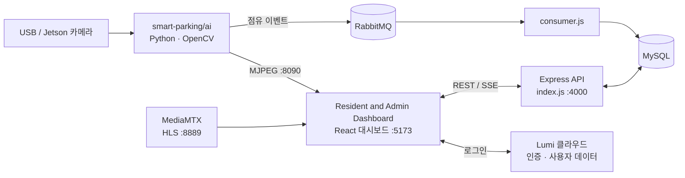
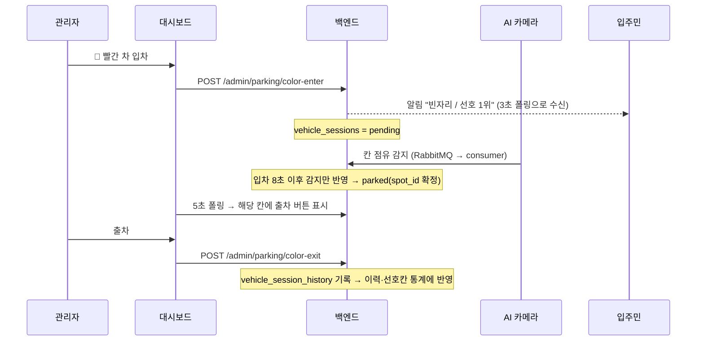

# 코드 구조: PCS Dashboard (프론트엔드)

## 1. 전체 시스템에서의 위치



이 대시보드가 데이터를 받는 출처는 두 가지입니다.

| 출처 | 파일 | 용도 |
|---|---|---|
| **백엔드 REST API** (MySQL) | `src/lib/api.ts` | 주차면 점유, 위반, 차량 세션, 선호 주차칸, 주차 이력, 알림, 방문자 등 **AI 카메라가 만든 실시간 데이터** |
| **Lumi SDK** (클라우드) | `src/lib/lumi.ts` | 로그인·역할(ADMIN/USER), 사용자·차량·방문자 엔티티 |

## 2. 폴더 구조

```
src/
├── main.tsx                 # React 진입점
├── App.tsx                  # 로그인 여부 + 역할로 관리자/입주민 라우트 트리 분기
├── index.css                # Tailwind base
│
├── hooks/
│   └── useAuth.ts           # lumi.auth 래퍼 → { user, isAdmin, isResident }
│
├── lib/
│   ├── api.ts               # 백엔드 API 함수와 응답 타입 (callBackend 한 곳에서 fetch/프록시 분기)
│   └── lumi.ts              # Lumi 클라이언트, 번호판 조회(resolveUserPlate), 공통 유틸
│
├── entities/                # Lumi 컬렉션 스키마 (users, user_vehicle, visitor)
│
├── components/
│   ├── admin/AdminSidebar.tsx        # 관리자 좌측 내비게이션 (대기 방문자 수 뱃지)
│   └── resident/ResidentBottomNav.tsx # 입주민 하단 탭 바
│
└── pages/
    ├── LoginPage.tsx
    ├── admin/
    │   ├── AdminDashboard.tsx       # 통계 카드, 시스템 상태, 불법주차 배너
    │   ├── AdminCCTV.tsx            # MJPEG/HLS 플레이어, 전체화면 모달
    │   ├── AdminViolations.tsx      # 위반 목록 (SSE + 폴링 fallback)
    │   ├── AdminParkingControl.tsx  # 색깔 기반 입차/출차 제어
    │   ├── AdminMembers.tsx         # 회원 목록
    │   └── AdminVisitors.tsx        # 방문자 승인/거절
    └── resident/
        ├── ResidentHome.tsx         # 빈자리, 선호 주차칸, 알림 배너
        ├── ResidentVehicle.tsx      # 내 차량 현재 위치
        ├── ResidentParking.tsx      # 주차 위치, 주차칸 분석
        ├── ResidentHistory.tsx      # 주차 이력 통계, 날짜별 리스트
        ├── ResidentVisitors.tsx     # 방문자 등록, 내 방문자 목록
        └── ResidentSettings.tsx     # 프로필, 로그아웃

functions/backend-proxy/     # (선택) Lumi Deno 엣지 함수. VITE_USE_DENO_PROXY=true일 때 API 중계
```

경로 별칭은 `@` → `src/`입니다 (`vite.config.ts`).

## 3. 라우팅과 인증

```
App.tsx
 ├─ 미로그인          → LoginPage (모든 경로)
 ├─ role = ADMIN      → /admin, /admin/cctv, /admin/violations,
 │                      /admin/parking-control, /admin/members, /admin/visitors
 └─ role = USER       → /resident, /resident/vehicle, /resident/parking,
                        /resident/history, /resident/visitors, /resident/settings
```

관리자와 입주민이 같은 페이지를 공유하는 경우는 없습니다.

## 4. 실시간 갱신 구조

| 화면 | 방식 | 주기 | 데이터 |
|---|---|---|---|
| 관리자 대시보드 | 폴링 | **3초** | 불법주차 (`/spots/forbidden-occupied`) |
| 관리자 대시보드 | 폴링 + SSE | 30초 | 점유율, 위반 수, 시스템 상태 |
| 위반 관리 | SSE (`/events/stream`) | 실시간 (실패 시 30초 폴링) | 미처리 위반 |
| 주차 제어 | 폴링 | 5초 | 주차면 상태, 차량 세션 |
| 입주민 홈 | 폴링 | **3초** | 인앱 알림 |
| 입주민 홈 / 내 차량 / 주차 위치 | 폴링 | 10초 | 빈자리, 선호 주차칸, 현재 위치 |

- 번호판(`plateNo`)은 마운트 시 한 번만 조회한 뒤 폴링에서 재사용합니다 (Lumi 호출 최소화).
- 모든 `setInterval`은 `useEffect` cleanup에서 해제합니다.
- 입주민 알림음은 iOS 자동재생 제한 때문에 첫 탭 때 잠금을 푼 `Audio` 요소를 재사용합니다.

## 5. 색깔 기반 입출차 흐름 (주차 제어)



## 6. 데이터 Fallback

| 데이터 | 실데이터 | 없을 때 |
|---|---|---|
| 번호판 | Lumi `user_vehicle` → 백엔드 `/users/plate` | `DEMO_PLATE` (`12가3456`) |
| 선호 주차칸 | 백엔드 집계 | "아직 주차 이력이 없습니다" |
| 홈 주차 통계 | `/spots/stats` | 기본값 (3칸) |
| 회원 목록 | 백엔드 `/users` | Lumi `users` 엔티티 |
