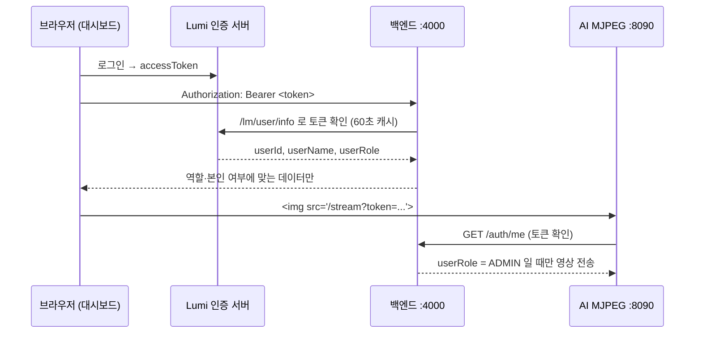

# 보안 (v2)

v2는 2026-11-24 보안 점검 결과를 반영했습니다. `v1-capstone/`에도 같은 수정과 v1 전용 수정을 적용했습니다 → [v1 SECURITY.md](../v1-capstone/SECURITY.md)

## 인증 · 권한 구조

| 구분 | 엔드포인트 | 접근 |
|---|---|---|
| 공개 | `GET /health` | 누구나 |
| 관리자 전용 | `/users`, `/cameras/stats`, `/violations/*`, `/events/stream`, `/spots/status`, `/spots/forbidden-occupied`, `/admin/parking/color-enter·color-exit·exit`, `/visitors/pending`, `/visitors/:id/approve·reject` | `ADMIN` |
| 로그인 사용자 | `/spots/stats`, `/auth/me` | `ADMIN`, `USER` |
| 본인 데이터만 | `/parking/history`, `/parking/spot-preference`, `/notifications`, `/notifications/:id/dismiss` (본인 번호판), `/visitors/my`, `/users/plate` (본인 이름), `POST /visitors` (주인 이름은 본인으로 강제), `/admin/parking/vehicle-sessions` (본인 차량만 반환) | `USER`는 본인만, `ADMIN`은 전체 |

- 입주민의 "본인 번호판"은 프론트 `resolveUserPlate`와 같은 순서로 정해요: Lumi `user_vehicle` → 이름으로 `VEHICLE_COLOR_MAP` → 둘 다 없으면 데모 번호판.
- `EventSource`(SSE)와 ``(MJPEG)는 헤더를 붙일 수 없어서 `?token=`으로 보내요. 토큰이 주소에 들어가므로 로그에 남지 않게 주의하세요.
- AI MJPEG 서버는 같은 PC(127.0.0.1)에서 오는 요청은 토큰 없이 허용해요 (로컬 `/snapshot` 확인용).

## 점검 결과와 조치

| 심각도 | 문제 | 조치 |
|---|---|---|
| 🔴 높음 | 백엔드 API에 인증이 없음. 누구나 회원 연락처 조회, 위반 처리, 출차, 방문자 승인 가능 | Lumi 토큰 검증 + 역할별 권한 + 본인 데이터 제한 (`backend/security.js`) |
| 🔴 높음 | 쿼리 객체 주입: `?plate_no[plate_no]=1` → mysql2가 `` plate_no = `plate_no` = 1 ``로 펼쳐 **전체 입주민 이력 유출** (재현 확인) | `query parser`를 `simple`로, 쿼리·바디에 객체/배열이 오면 400 |
| 🔴 높음 | Docker 포트(MySQL, Adminer, RabbitMQ 관리 화면)가 네트워크에 열려 있고, 접속 비밀번호는 공개 저장소에 있음 | DB·관리 화면은 `127.0.0.1`로만 바인딩, 비밀번호는 `infra/.env`로 변경 가능 |
| 🟠 중간 | Deno 프록시 SSRF: `path`에 `@evil.com`을 넣으면 외부로 요청 | 상대 경로만 허용 + 최종 주소가 백엔드와 같은 출처인지 확인, GET/POST만 |
| 🟠 중간 | 의존성 취약점 (개발 의존성 포함): 백엔드 8건(critical 1), 프론트 77건(high 35). 특히 **Vite 5 개발 서버의 Windows 경로 우회·파일 노출** 취약점은 `pnpm dev --host`로 네트워크에 열 때 실제 위험 | 백엔드 **0건**, 프론트 **2건**(아래, 해당 없음). Vite 5.4.2 → **6.4.6**, ESLint·Tailwind·PostCSS 같은 메이저 안 최신, framer-motion 12.43. Vite 6 개발 서버에서 `.env`·`/@fs/C:/Windows/...` 접근이 403으로 막히는 것 확인 |
| 🟡 낮음 | 500 응답에 DB 에러 메시지 노출 (백엔드 13곳 + Deno 프록시) | 제거. 마지막 에러 핸들러로 스택 트레이스도 숨김. `X-Powered-By` 제거 |
| 🟡 낮음 | CORS 전체 허용, SSE `Access-Control-Allow-Origin: *` | 대시보드 주소 허용 목록 (`CORS_ORIGINS`) |
| 🟡 낮음 | AI 카메라 영상이 인증 없이 공개 | 관리자 토큰 필요. 단일 스레드라 한 명만 볼 수 있던 문제도 수정 (최대 5명) |
| 🟡 낮음 | 요청 제한·입력 길이 검증 없음, 알림이 메모리에 무한정 쌓임 | IP별 분당 600회, 바디 20KB, 방문자 입력 길이·날짜 형식 검증, 알림 최대 1000건, SSE 최대 50 연결 |

검증: 격리된 MySQL과 가짜 Lumi 서버(관리자·입주민 토큰)로 50개 항목 테스트 (인증 누락·위조 토큰·권한·본인 데이터·객체 주입·입력 검증·CORS·정상 흐름), MJPEG 7개 항목 테스트 → 모두 통과.

## 남은 위험 (알고 쓰기)

| 항목 | 내용 | 권장 |
|---|---|---|
| RabbitMQ 5672 | 카메라 장치용으로 네트워크에 열려 있음. 비밀번호를 아는 사람은 가짜 감지 이벤트를 보낼 수 있음 | 공용 네트워크에서는 `infra/.env`로 비밀번호 변경, 또는 카메라 장치가 없으면 `127.0.0.1:5672:5672`로 바꾸기 |
| HLS 8889 / RTSP 8554 | MediaMTX 스트림에 인증 없음 (현재 데모는 MJPEG만 사용) | 실제 카메라를 붙일 때 MediaMTX `authInternalUsers` 설정 |
| `react-router` moderate 2건 | 7.x 메이저 업그레이드가 필요. 신뢰할 수 없는 경로로 이동하는 경우, 서버 렌더링 하이드레이션인 경우에만 해당 → 고정 경로 + `BrowserRouter`인 이 앱에는 해당 없음 | 메이저 업그레이드 시 함께 처리 |
| 알림 저장소 | 인메모리 (서버 재시작 시 초기화) | 운영 시 DB 테이블로 |
| HTTP | 로컬 네트워크용이라 HTTPS가 아님. 토큰이 평문으로 오감 | 외부 공개 시 HTTPS 리버스 프록시 필수 |

## 운영 체크리스트

- [ ] **Windows 방화벽**: Node.js, python, Docker Desktop Backend 허용 규칙을 **Public → Private 프로필**로만 제한 (공용 와이파이 차단)
- [ ] `infra/.env`에서 개발용 비밀번호(`rootpass`, `apppass`) 변경 → `backend/.env`도 같이 변경
- [ ] `backend/.env`에 쓰지 않는 키(예: 예전 `ANTHROPIC_API_KEY`)가 남아 있으면 삭제
- [ ] 대시보드 주소가 기본값(localhost, 192.168.137.1)과 다르면 `backend/.env`의 `CORS_ORIGINS`에 추가
