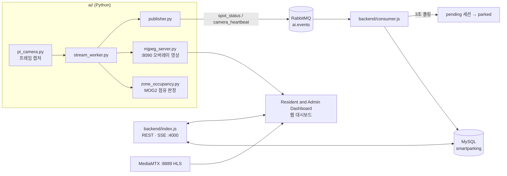

# 코드 구조: PCS Backend · AI · Infra

## 1. 데이터 흐름



1. **AI**: 프레임마다 구역 폴리곤 안의 전경 비율을 계산합니다. 상태가 바뀌었거나 30초가 지나면(강제 재전송) `spot_status` 이벤트를 발행하고, 30초마다 `camera_heartbeat`도 보냅니다.
2. **consumer.js**: 이벤트를 트랜잭션으로 처리합니다. 장치·카메라 자동 등록 → `spot_status_logs` 저장 → 금지구역이면 위반 생성, 비면 위반 해제.
3. **consumer.js 폴링**(3초): `pending` 차량 세션마다 **입차 8초 이후** 점유된 칸 중 confidence가 가장 높은 칸을 골라 `parked`로 확정합니다 (팔 오인식 방지).
4. **index.js**: 대시보드에 REST API를 제공하고, 5초마다 미처리 위반을 SSE로 브로드캐스트합니다.

## 2. 폴더 구조

```
ai/
├── main.py                  # 진입점: MJPEG 서버 + StreamWorker 시작
├── config.py                # .env 로드 (SERVER_IP, CAMERA_SOURCE, CAMERA_CODE …)
├── calibrate_zones.py       # 구역 폴리곤 좌표 측정 도구 (마우스 클릭)
├── camera/
│   ├── pi_camera.py         # OpenCV 캡처 래퍼 (웹캠 / RTSP / 동영상)
│   └── stream_worker.py     # 캡처 루프, 자동 재연결, 이벤트 발행, 하트비트
├── detection/
│   ├── zones.py             # 카메라별 주차 구역 폴리곤 (spot_id = DB parking_spots.spot_id)
│   ├── zone_occupancy.py    # MOG2 배경 차분, 워밍업 후 배경 고정, 디바운스, 오버레이
│   ├── detector.py          # (확장용) YOLOv8 차량 탐지. 현재 실행 경로에선 미사용
│   └── export_onnx.py       # (확장용) YOLO → ONNX 변환
├── messaging/publisher.py   # RabbitMQ 발행 (pika, 자동 재연결)
├── streaming/mjpeg_server.py# /stream, /snapshot
├── requirements.txt         # PC용 (opencv-python, pika, dotenv)
├── requirements-yolo.txt    # (선택) YOLO 확장용 ultralytics
├── requirements_jetson.txt
└── setup_jetson.sh          # Jetson Orin Nano 초기 설치

backend/
├── index.js                 # Express API 서버 (아래 API 목록)
├── security.js              # Lumi 토큰 검증, 역할 권한, 본인 데이터 제한, 입력 검증, CORS, 요청 제한
├── consumer.js              # RabbitMQ consumer + pending 세션 확정 폴링
└── producer.js              # 하드웨어 없이 테스트 이벤트 발행 (npm run test:event)

db/
├── schema.sql               # 전체 테이블 정의
├── seed.sql                 # 코드 테이블, 기본 주차면/장치
└── demo-seed.sql            # 발표용 데모 데이터 (3칸 + 금지구역, 선호칸 이력)

infra/
├── docker-compose.yml       # mysql, rabbitmq, mediamtx, adminer
└── mediamtx.yml             # RTSP 수신 → HLS 변환
```

## 3. 점유 판정 알고리즘 (`zone_occupancy.py`)

```
프레임 → 그레이스케일 → 구역별 MOG2.apply(learningRate)
          ├─ 워밍업(WARMUP_FRAMES=20) 동안: lr=-1  (빈 주차장을 배경으로 학습)
          └─ 이후: lr=0  (배경 고정. 오래 서 있는 차가 배경으로 흡수되지 않음)
       → 전경 픽셀 비율(ratio) > 구역 threshold ?
       → 연속 DEBOUNCE_FRAMES(5) 회 초과 시 점유 확정 / 0회가 되면 비어있음
```

## 4. REST API (`index.js`)

> `/health`를 제외한 모든 API는 `Authorization: Bearer <Lumi 토큰>`이 필요해요. 관리자 전용 / 본인 데이터만 구분은 [SECURITY.md](../../SECURITY.md) 참고.
> `GET /auth/me`: 로그인 사용자 정보 (AI MJPEG 서버가 관리자 토큰 확인에 사용)

| 분류 | 엔드포인트 | 설명 |
|---|---|---|
| 상태 | `GET /health` | DB 연결 확인 |
| | `GET /cameras/stats` | 카메라 온라인/오프라인 (하트비트 기준) |
| 주차면 | `GET /spots/stats` | 활성 주차면 수 / 점유 수 (금지구역 제외) |
| | `GET /spots/status` | 주차면별 현재 점유와 번호판 |
| | `GET /spots/forbidden-occupied` | 불법주차: `forbidden`(금지구역) + `double_parked`(이중주차) |
| 위반 | `GET /violations/open` | 미처리 위반 |
| | `POST /violations/:id/resolve` | 처리 완료 |
| | `GET /events/stream` | SSE: 미처리 위반 실시간 |
| 입출차 | `POST /admin/parking/color-enter` | `{color}` 입차 → pending 세션 + 입주민 알림 |
| | `POST /admin/parking/color-exit` | `{color}` 출차 → 이력 기록 + 알림 |
| | `POST /admin/parking/exit` | `{spot_id}` 수동 출차 (금지구역용) |
| | `GET /admin/parking/vehicle-sessions` | 색깔별 세션 상태 |
| 입주민 | `GET /parking/spot-preference?plate_no=` | 선호 주차칸 TOP 5 + 빈자리 여부 |
| | `GET /parking/history?plate_no=` | 이용 통계 + 최근 20건 |
| | `GET /notifications?plate_no=` / `POST /notifications/:id/dismiss` | 인앱 알림 (인메모리) |
| 회원 | `GET /users`, `GET /users/plate?name=` | 회원 목록, 이름 → 번호판 |
| 방문자 | `GET /visitors/pending`, `POST /visitors/:id/approve`, `POST /visitors/:id/reject` | 관리자 승인 |
| | `POST /visitors`, `GET /visitors/my?host_name=` | 입주민 등록 / 조회 |

## 5. DB 테이블 (`schema.sql`)

| 그룹 | 테이블 |
|---|---|
| 사용자·차량 | `users`, `plates`, `user_vehicles`, `visitor_passes` |
| 장치 | `devices`, `cameras`, `camera_zones`, `camera_heartbeats` |
| 주차면 | `parking_spots`, `spot_types`, **`spot_status_logs`** (모든 실시간 데이터의 원천) |
| 이벤트 | `event_types`, `parking_events`, `lpr_reads`, `parking_sessions` |
| 위반 | `violations`, `violation_types`, `violation_statuses`, `evidences`, `violation_actions`, `action_types` |
| 입출차 세션 | **`vehicle_sessions`** (color PK, pending → parked → exited), **`vehicle_session_history`** |

## 6. 이벤트 메시지 형식 (RabbitMQ `ai.events`)

```json
{
  "event_id": "uuid",
  "event_type_code": "spot_status",
  "camera_code": "CAM-A-G-01",
  "device_code": "CAM-A-G-01",
  "camera_role": "parking_view",
  "ts": "2026-05-31T12:00:00+00:00",
  "spot_id": "A1-002",
  "plate_text": null,
  "confidence": 0.61,
  "image_ref": null,
  "payload": { "is_occupied": 1 }
}
```

`event_type_code`: `spot_status` | `camera_heartbeat` | `plate_detected` (`producer.js` 테스트용)

## 7. 알려진 한계

- 입주민 알림은 인메모리 배열이라 서버를 재시작하면 사라집니다.
- 차량 식별은 색깔↔번호판 하드코딩(`VEHICLE_COLOR_MAP`)으로 대신합니다. 실제 환경에서는 번호판 인식(LPR)으로 바꿔야 합니다.
- 입출차 트리거는 관리자 버튼으로 대신합니다 (게이트 센서 없음).
